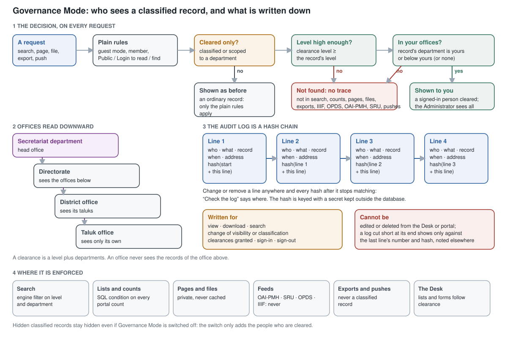

# Government and institutional use

For a ministry, department, court, council or any institution that must be able to show **who may
see what, and who did see what**. Everything here belongs to the *governance edition* ([Editions](installation.md#editions)): a standard install has none of it. On that edition it is switched on with one setting and is off otherwise, so an open library pays nothing for it.

**Governance Mode** is in Desk → Research Desk → **Settings** → *Government and institutional use*.
Only an administrator (System Manager or SOK Super Admin) can change it. The box is shown on every install but does nothing on a standard one.

This page is the whole design. [What you get](#what-you-get) and [Setting it up](#setting-it-up)
are for the people running it; [How it works](#how-it-works) and
[Where it is enforced](#where-it-is-enforced) are for the people who must trust it.

## What you get

| | |
|---|---|
| **Classification** | each record has a level (Unclassified, Restricted, Confidential; Secret and Top Secret on a Classified-mode installation) and optionally a department |
| **Need-to-know** | a person sees a record only with a clearance: a level, and the departments (and the offices below them) they belong to |
| **Audit log** | every view, download, search, change of visibility or classification, clearance granted, sign-in and sign-out, in a log that cannot be edited and shows any tampering |
| **Separation of duties** | the role **ResDesk Security Officer** grants clearances and classifies; the role **ResDesk Records Officer** approves disposal and legal holds; a system administrator holds no clearance by role; the department tree belongs to the super admin |
| **Retention** | retention rules, a daily list of what is due, disposal only on a records officer's approval, and legal holds that nobody can override |

It does not make an installation *approved*. That is for your security officers and an audit
(for an Indian government body, normally by a CERT-In empanelled auditor before it goes live), and
this page describes what the software does, not what the law requires: check each requirement with
your legal and records officers.

## Setting it up

0. **Install the governance edition**: `./install.sh --edition governance`, or `RESDESK_EDITION=governance` in `.env` and `./upgrade.sh`. The Security Officer and Records Officer roles below exist only on this edition.
1. **Switch on** Governance Mode (Settings → *Government and institutional use*).
2. **Departments** (Desk → Research Desk → Running the Library): enter the tree, top first. Each
   office has the office it reports to. A super admin keeps this.
3. **Security officers**: give the role **ResDesk Security Officer** to the people who will grant
   clearances (People & Roles).
4. **Clearances**: for each person who may see more than unclassified, department-free records,
   add a clearance: a level and the departments they belong to. An officer can only grant
   within their own level and departments, never to themselves.
5. **Classify**: tick records in **Items → Actions → Set Classification**, or add a line for one record
   in **Classified Records** (its level and department). Only a security officer, a manager or a
   super admin can, never above their own clearance. Deleting a record's line declassifies it.
6. **Check the log** now and then (Audit Log → *Check the log*) and write down the last line's
   number and hash somewhere else.

Governance Mode cannot be switched off while classified records exist.

## How it works

### One rule, hiding first

A classified or department-scoped record carries the visibility **Cleared only**. It is not one of
the three choices a person makes by hand and it is not in the plain rules at all: the rules that
decide whether a guest or a reader may find or read a book (`core/access.py`) answer *no* to it for
everyone. The people who are cleared reach it through one door, `access.effective()`, which gives
them the record as if it were members-only. So a place that was never taught about classification
fails **closed**: the record is simply not there.

The hiding does not depend on Governance Mode being on, or readable: with the switch off a
classified record stays hidden from everyone, and the switch only adds the people who are cleared.

### The decision

For a request that reaches a record (a search hit, a page, a file, an export, a push):

1. The plain rules (guest mode, member or not, Public / Login to read / Login to find) apply as
   they always did.
2. If the record is not *Cleared only*, that is the answer.
3. Otherwise the person must be signed in and a member, their **level** must be at least the
   record's, and the record's **department** must be empty, or one of their departments or below one.
4. If any step fails, the record is **not found**: no trace in search, counts, facets, pages,
   files, exports, IIIF, OPDS, OAI-PMH, SRU or pushes.

The pure rules are in `core/classification.py` of the governance app (levels, `expand`, `cleared`, and the two filters
built from a clearance) with unit tests; `clearance.py` applies them.

### Departments and clearances

**Departments** is a tree: each has the office above it. A person sees a record when their level is
at least the record's and the record's department is theirs **or below theirs**: a directorate sees
its district and taluk offices, a taluk office sees only its own. A record with no department is
open to anyone cleared for its level. A person with no clearance sees only Unclassified records that
belong to no department. Nobody has a clearance by role (not a System Manager, not a manager); only
the built-in **Administrator** account sees everything, and its use is in the audit log.

Rules that keep it honest: a level is never granted above the grantor's own; departments granted must
be within the grantor's own; nobody edits their own clearance; the tree is kept by super admins, so
a security officer cannot place their own office above the rest; a department name cannot contain `%`.
Granting or removing a clearance is in the audit log.

### Where the level and department live

A classified record has one line in **RD Item Scope** (its level and department; none means
unclassified, and it is kept apart because the item's own table is full) and the visibility
*Cleared only*. Every record and every page of its text in the search engine carries `class_rank`
(the level as a number) and `department`, beside `visibility`. A person's search is filtered by
`NOT visibility = "Cleared only" OR (NOT class_rank > N AND (department is empty OR in [their
offices]))`; documents indexed before the fields existed count as level 0 with no department. The
same condition, written for SQL, is added to every portal count and list. Changing a classification
updates the records and the index together (at once for up to 200 records, in the background for more).

### The audit log

With Governance Mode on, Research Desk writes a line for each of these:

| What | When |
|---|---|
| `view` | a book's page is opened (the same person opening it again within five minutes counts once) |
| `download` | a PDF or other file is served (a viewer asking for the rest of a file it began is not counted again) |
| `search` | a search with words, and the words (first 200 characters) and mode used |
| `visibility`, `classification` | who can see a set of books, or their level, was changed, and how many |
| `clearance` | a clearance was granted, changed or removed |
| `login`, `logout` | a person signs in or out |

Each line has a number, the time, the person (or `Guest`), the record, the detail and the address
the request came from.

**It cannot be edited or deleted** from the Desk or the portal, and every line carries a hash of the
line before it, keyed with a secret that is kept outside the database. If a line is changed, or
removed, directly in the database, **Check the log** (Desk → Research Desk → **Audit Log**) says at
which line the chain breaks. The same check is `sok_resdesk_governance.audit.verify`. Lines are written under a
short database lock, so the order is the order of the numbers; a reader is never stopped because the
log could not be written (that failure shows once a minute in the Error Log).

Two limits to know. A log **cut short at its end** leaves a chain that still checks: the check
therefore reports the last line's number and hash, and you should note them somewhere else (a
register, an email to the records officer) now and then. And someone who holds both the database
and the site's encryption key could rewrite the whole log: keep database backups where the same
people cannot write to them.

Managers can read the log; only administrators can export it, because it holds addresses and search
words. Search words and addresses are personal data in many places (in India, the Digital Personal
Data Protection Act 2023): decide how long you keep the log and who may read it; a retention policy
for the log is on the [roadmap](roadmap.md).

### Retention and legal holds

Desk → Research Desk → Running the Library: **Retention Rules**, **Legal Holds**, **Disposals**.
These need the role **ResDesk Records Officer**; they do not depend on Governance Mode (the department
choices only mean something with it). Research Desk **never disposes of anything on its own**.

- **A retention rule** says how many years records are kept, counted from the *year of the record* or
  the day it was *added*, optionally for one department (and the offices below it) or one collection,
  and what then happens: *Review only*, *Transfer to archives* or *Destroy*. When several rules match a
  record the **longest period governs** (on a tie, the more cautious action), so a new rule cannot
  shorten a record's life by accident. A record with no year is not dated on the first basis.
- **The daily list.** Each day, for every rule with records due, a draft **Disposal** is made: the
  records and when each fell due (not their titles or levels, so nothing about a classified record
  is shown to someone who cannot see it). A record under a legal hold is never listed, and one that was
  kept is not listed again for 30 days. A record that any matching rule cannot date (no year) is left
  alone. Up to 2,000 records per list; there is one open list per rule. Only Research Desk makes or
  changes a Disposal: it cannot be created, edited or deleted by hand, and cancelling is for drafts only.
- **Approval.** The records officer reads the list and approves it (or cancels it). Only then are the
  records dealt with, in the background. Each is checked again just before it is dealt with, against the
  live data: a hold placed since the list was made wins, the record must still be due under an enabled
  rule, and a record the approver is not cleared for is left for an officer who is. *Destroy*
  removes the catalogue record, its search entries and its page text; *Transfer to archives* marks it
  transferred on the list (the physical or file transfer is yours, and the list is the manifest);
  *Review only* just records that someone looked. The finished Disposal carries a certificate line and
  is kept, and approval and completion are in the audit log.
- **A legal hold** (a court order, an audit, an inquiry) names records, a whole department, or both,
  with the order's reference and the reason. While it is active its records are never listed for
  disposal and **cannot be deleted by anyone**, the built-in Administrator included: the hold must be
  released first. A held record's department cannot be changed, nor its classification removed, until
  then. A hold is never deleted, a released hold cannot be edited, and placing, changing (with the
  records taken off it) and releasing are in the audit log. A department hold covers the records that
  have a department (a record with none is covered only if named).

What it does not do: *Destroy* does not erase the files in the library's storage or in a backup (the
certificate says so); a public book that is destroyed still leaves its tombstone, so its permanent
address answers; a direct database deletion bypasses a hold. A destroyed record is gone: take the
backup and the approval seriously.

### File register

Desk → Research Desk → Running the Library → **File Register**. A **file** is what an office keeps
together: it has a number (the department's own, for example `ED 12 SLB 2026`, or `F-2026-00001` if
left empty; numbers starting `F-` are Research Desk's own), a subject, a level and a department, where it is (*Place*), who has it, the records in
it, and its movements. It works for paper files and for digital ones.

- **Same need-to-know as a record.** A file with a level or a department is seen only by people
  cleared for it, in lists, forms and reports, whether or not Governance Mode is on. A file is
  classified by the same people as a record (security officers and managers) and never above their
  clearance, and so are its records and its movements (also when read through the API). A file must be
  **at least as restricted as every record in it**, in the same office or above, and nobody files a
  record they cannot see. That is checked when the file is saved: a record classified higher later does
  not change the file, so raise the file's level too (a file cannot be sent to someone who is not
  cleared for the records in it).
- **Movement.** The person who has a file (or a records officer) **sends** it to a colleague, with
  remarks; it stays with the sender until the colleague **receives** it, which makes them the holder.
  A file cannot be sent to a person who is not cleared for it (or for what is in it), or who has no
  Desk role, and not while it is still on its way; the answer is the same in each case. Every send and receive is a line in the file's *Movement* table and in the
  audit log.
- **The holder and the movements are not editable.** They change only through send, receive, close
  and reopen. Only the holder or a records officer edits an open file. **Close** it when the work is
  done (a closed file is read-only); only a records officer **reopens** it.
- **Never deleted.** A file is closed, not removed: the register is the record. (It does not yet feed
  the retention rules, which count from a record's year or the day it was added.)

### Directory sign-in

People sign in with the department's own accounts instead of passwords kept here: **LDAP** (Active
Directory, OpenLDAP or another) or **single sign-on** through an OpenID Connect or OAuth 2 provider
(Keycloak, AD FS, Azure AD, or a government identity service that speaks OpenID Connect). Frappe does
the signing in (Desk → Administration → **LDAP Settings** and **Social Login Keys**; the sign-in page
shows the buttons by itself). Research Desk adds the rules below. The protocol details here come from
reading Frappe's own source; check them against the Frappe version you run.

- **A directory proves who someone is; it does not make them an officer.** Mapping a directory group
  to **System Manager, SOK Super Admin, ResDesk Security Officer, ResDesk Records Officer** or a
  scripting or website administration role (or making one the default role) is refused when the
  settings are saved, however the role is spelt. Give those duties in the Desk (People & Roles). A
  site that really wants a group to carry one names it in `resdesk_directory_roles_allowed` in the site
  configuration. Ordinary roles (reader, depositor, proofreader, cataloguer, manager) may be mapped,
  and *Default User Type: System User* with a Desk role gives the Desk to everyone in the directory:
  leave it on Website User.
- **A directory cannot sign in as an officer who was not made through it.** LDAP matches an existing
  account by email; a sign-in into an account that carries one of those duties, and that the directory
  did not create, is refused. Such accounts keep their own password. The directory's settings are
  checked again at every directory sign-in, which is refused while they break the rules.
- **Clearances never come from a directory.** A person from the directory sees what any member sees until
  a security officer grants a clearance.
- **LDAP must be encrypted and the server checked**: `ldaps://` or StartTLS, and *Require Trusted
  Certificate* set to Yes, or the settings are not saved (the check runs before Frappe tries the
  connection with the service password).
- **Single sign-on providers use https** (a provider on this machine may use http), and the options
  that let a provider's email claim take over an existing account (*trust email without a verified
  claim*, *trust any tenant*) are refused.
- **Leavers.** Every person who signs in through the directory is listed under **Directory Sign-ins**.
  Each night Research Desk looks each LDAP account up with the same filter used to sign in (with
  the user name, and with the email); one the directory no longer has for **two checks in a row** is
  switched off and signed out, and the audit log says so. Nothing is changed when the directory cannot
  be reached, when its user search answers as though empty, or when the check would switch off more
  than a fifth of everyone at once (that is more likely a wrong filter than a thousand leavers: it is
  written to the Error Log instead). The built-in Administrator and the last enabled system manager
  (the Administrator is not counted) are never switched off, and a person switched off is brought back
  by an administrator, not by signing in again. Sign-ins through the directory are marked in the audit log.
- **The Server page** shows the directory and warns if a setting no longer meets these rules (for
  instance after a change made directly in the database).

What it does not do. **SAML** is not part of Frappe: put a bridge that speaks OpenID Connect in front
of a SAML identity provider (Keycloak does: see [Single sign-on with Keycloak](keycloak.md)). Frappe maps LDAP groups to roles but not
single sign-on claims, so single sign-on people get their roles in the Desk. A single sign-on
leaver is not found by the nightly check (the provider has no directory to ask): shorten the session
life (System Settings) and disable the account at the provider. LDAP is not covered by the Classified
mode guard, which watches web requests and mail only, so in Classified mode the settings are refused
unless the directory and the provider's addresses are the machine itself or hosts named in
`resdesk_allowed_hosts`, a directory sign-in is refused while they are not, and the nightly check does not run. With two-factor sign-in on, an LDAP sign-in goes through Frappe's second
step and is not noted, so that person is not in the nightly check: switch them off by hand. After an
upgrade, existing Social Login Keys may carry the trust options Frappe sets on upgrade; they must be
cleared before the key can be saved.

### Disclosure requests and redaction

Desk → Research Desk → Running the Library → **Disclosure Requests**. For a request to see records (a
right-to-information application, a court or audit request, an internal one). Only the records
officer (and the Super Admin) work with them.

- **A request** has the applicant, what is asked for, the day it arrived and the day the reply is
  owed (the arrival day plus *Days to Reply to a Disclosure Request* in Settings, 30 by default; set it
  to what the law says), and the records it concerns. A request is never deleted. The list view shows when each is due.
- **Need-to-know.** A request is seen only by someone who may see **every record it lists**, and nobody
  lists a record they may not see (the answer is the same for a missing record). It is the same rule
  as for a file. Creating a request, previewing a page, deciding, starting the package and
  closing are in the audit log.
- **A decision for each record**: *Disclose* (the whole file), *Disclose redacted* (parts covered), or
  *Withhold*. Keeping back or covering anything needs the **ground** relied on, which is told to the
  applicant. Parts to cover are rows in *Covered Parts*: record, page, and a box in percent of the
  page (from the left, from the top, width, height) with an optional reason. **Cover Parts of a Page**
  shows a page and lets you draw the boxes on it with the mouse or a finger (or type the four numbers,
  which the box follows); *Add This Box* puts it in the table, and *Save* keeps it. Only an officer cleared
  for the record is shown its page. **Preview a Page** shows a page as it would be released.
- **Decide, then make the package.** *Decide* checks that every record has a decision and a ground where
  one is needed, that every covered part lies on its page, and that boxes belong only to records set
  to *Disclose redacted*, and that no box is on a page the record does not have (such a box would cover
  nothing, so it is refused). It also notes the fingerprint of each file and its level. Changing the
  records, boxes or reasons after that puts the request back in review, and so does a changed file or
  level before the package is made (decide again). *Make the Package* then builds, in the background, a ZIP: whole files as they are, a **redacted copy** of
  each covered record, and `reply.txt`, which lists each record, the decision, the ground, your
  reasons. A withheld record is named by its number only, not its title, since the title may be
  what is withheld; a covered box carries the record's *ground* in small white letters (a box's own
  *Internal Note* is never printed) and the *Appeal Note* from Settings. The package is a private file on the request with its
  SHA-256, and its making is in the audit log. Hand it over yourself: Research Desk sends no e-mail
  about requests.
- **Redaction is real.** A redacted copy is a picture of each page (200 dpi) with the boxes burned
  in, assembled into a PDF: nothing under a box, not text, not image data, is in the file. The price is
  that the copy has no text layer (so it cannot be searched or read aloud) and is larger than the
  original; at most 400 redacted pages go in one package (split a larger request), and a page too
  large to draw is refused. A package that is still *Preparing* after two hours (its worker died) can be made
  again. It needs `pdftoppm` (poppler-utils) on the server; without it redaction is refused rather than done
  loosely.

What it does not do yet: text found on a page cannot be covered by searching for it; parts of a photograph or a recording
cannot be covered (it is disclosed whole, with its files as kept, or withheld); and
redaction covers the PDF only, not the catalogue entry, page text or notes of the record. Whether
a ground applies is the officer's decision, not the software's.

## Where it is enforced

| Surface | How |
|---|---|
| Search and facets | the engine filter above, added to every book and page search, including inside one book |
| Counts and lists on the portal | the SQL condition (`access.sql_condition`) |
| The book's page and its files | `get_record` and the file endpoint use the person's own view; classified files are sent `private, no-store`, never cached |
| OAI-PMH, SRU | the harvest condition excludes *Cleared only* in every scope |
| OPDS, IIIF, annotations, page text | the plain rules answer *no* (fail closed) |
| Exports and bulk actions | `select_items` drops what the person is not cleared for; the all-records MARCXML and usage reports skip classified records |
| Pushes (Koha, webhooks, archive.org), Commons upload, DOIs | never for a classified record |
| Deletion | a deleted classified record leaves no public tombstone |
| Embargo end | does not make a classified record public |
| The Desk | lists and forms of items, and of their page text, notes, flags, ground truth and push records, follow the person's clearance |
| Bulk visibility and rules | skip classified records: their visibility is their classification's |

### What this does not cover yet

**Counts on staff screens.** The workspace dashboard leaves classified records, and the notes and page
text of them, out of every number. The review queue lists, counts and checks only the records the
reviewer is cleared for. The one number that still includes them is the *page documents* count of the
search engine on the Server page (a total for the whole index, with no titles): treat it as
unclassified information.

**Archival units and deposits cannot be classified.** Do not enter classified material in them. A
classified book's public notes and its archival units are hidden from the portal for everyone (failing
closed), so cleared people do not see them there either. A deposit, once accepted, becomes a record that
can be classified like any other.

**A file and its records.** Classifying a record above the file it is filed in (or in an office the file
is not in or above) is refused, with the number of files to raise first; lowering a record's level
leaves the file as it is.

## Deploying it

**One installation** is the default: Governance Mode on the library's own server, behind its login.
For a government body, host it in the department's own data centre (in India, with data kept in the
country), switch on **Login required** under *Visitors who are not logged in* (Settings → Access &
Sign-up) so the whole portal is behind sign-in, and use HTTPS.

### Classified mode

For Secret and Top Secret records, and part of the governance edition: `--classified` installs that edition, and `install.sh` refuses `--classified` with `--edition standard`. On an existing standard install, set `RESDESK_EDITION=governance` and run `./upgrade.sh` first. Chosen when installing (`./install.sh`, the question *"Will this
installation hold Secret or Top Secret records?"*, default no; or `--classified`), or later by
`RESDESK_CLASSIFIED=1` in `.env` and a restart, or `bench --site NAME set-config resdesk_classified 1`
on the host. It lives in the site configuration, outside the database, so no Desk setting can switch
it off: turning it off means `bench set-config` on the host, and **anyone who can run code on the
host, or enable Server Scripts in the Desk, can also change it**. It:

- **refuses every outside web request and outgoing mail connection** that is not to the machine
  itself, the search engine, the Docker monitor, or a host you name in `resdesk_allowed_hosts` (a
  list; `.gov.example` allows that whole domain). It is a guard on the `requests` library and on
  `smtplib`, in web requests, background jobs and migrations (not in `bench console` or `bench
  execute`), and it checks each call, so another site on the same bench is not bound by it;
- **keeps Governance Mode on, the portal behind sign-in, and the features that talk to outside
  services off** (sharing, repositories, authorities, library systems, usage statistics, update
  checks, the alert webhook), whatever Settings says: those fields are re-set on every save and migrate.
  Scheduled ingests from archive.org, repositories and Wikisource are set to Manual;
- **turns the updater helper off**, which fetches code and images from outside;
- **keeps what readers searched for out of the audit log** (it records that a search was made);
- shows **Classified mode** on the Server page's health list, with a warning if the guard is not
  installed or the portal is not behind sign-in.

What it cannot do: the guard covers what Research Desk itself sends through those two libraries,
not IMAP, LDAP, the PDF renderer fetching a remote picture, or another program on the machine. The
firewall and the network around it (no route to the internet), and encryption of the disk, are yours
to set up and to confirm. This mode makes the software suitable; it does not make an installation
approved.

### The public mirror

For a body that holds confidential and public records both: a second, read-only Research Desk on
another container or server that holds **only what the main system has released**. The main system
alone decides what is public; the mirror cannot ask for anything.

- **Push, never pull.** The main system sends to the mirror. The mirror has no address, key or
  password for the main system, so the main system can stay on an internal network with a route out
  to the mirror alone.
- **The release gate** (`outbound.releasable`): a book is sent only when it is published, Public,
  Open, a book of the library's own (files on its storage, not an archive.org book), and has no
  classification line. Nothing else is sent, whatever the push target's scope says.
- **Taken back at once.** A book that is classified, unpublished, made less than public or deleted is
  withdrawn from the mirror (its record, its search entries and its files) soon after the
  change (normally within a minute), at the end of every push run, and again by an hourly pass for anything missed (the mirror was out of reach). A withdrawal
  is made even while the target is switched off or in a Dry Run, and deleting the target first takes
  its books off the mirror (and is refused if the mirror cannot be reached).
- **The mirror is a library like any other**: search, the reader, IIIF, OAI-PMH and OPDS work on
  it. It has no staff accounts of its own to give; run it with sign-in off and Governance Mode off.

Setting it up:

1. **Mirror**: install Research Desk on the second server; put `RESDESK_MIRROR_TOKEN=` followed by
   a long random secret (at least 32 characters) in its `.env` and restart. It is written to the site configuration
   (`resdesk_mirror`, `resdesk_mirror_token`), outside the Desk, so no one there can change it. It must
   be reached over HTTPS.
2. **Main system**: Desk → Research Desk → **Push Targets** → new, *Send To* **Public mirror**,
   the mirror's address and the same token. **Test Connection**, then leave Dry Run on for a first
   run, look at the log, and untick it. Tick *Send Changes Automatically* to send each change within
   a minute.
3. **Classified mode**: add the mirror's host to `resdesk_allowed_hosts`. The Public mirror is the one
   push target that stays available in Classified mode.

What it does not do: it does not send archive.org books (the mirror can ingest those itself), it does
not carry readers' notes, accounts or search history, and a book once seen by the public may have been
copied by them: withdrawal removes it from the mirror, not from anyone's disk. The token is a shared
secret: rotate it by changing both ends.

## What comes next

Records intake, signature
checks and an offline install bundle are planned: see the [roadmap](roadmap.md).
